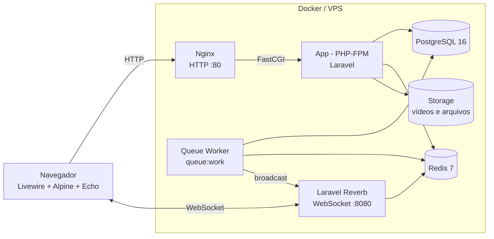
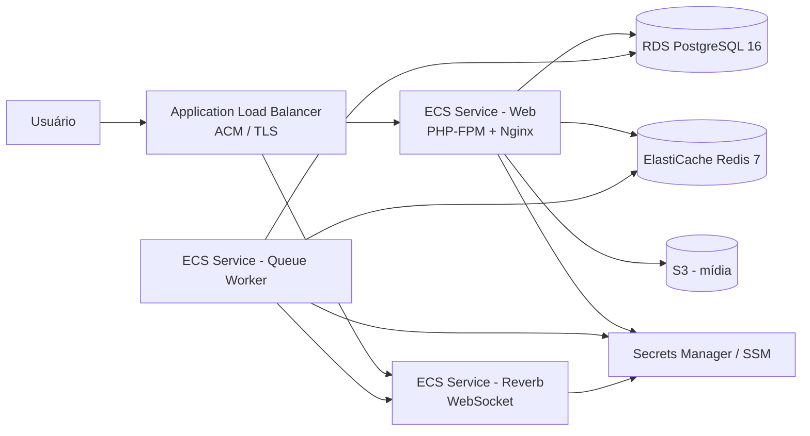

# IAVA

Plataforma educacional full stack para professores e alunos, com gestão de disciplinas, aulas, atividades avaliativas, fórum, mensagens e notificações em tempo real.

O IAVA (antigo Ailumnus) centraliza o dia a dia de uma turma: o professor organiza conteúdos e avaliações, acompanha entregas e se comunica com os alunos; o aluno acessa aulas, responde atividades, consulta notas e participa do fórum e do chat.

## Visão geral

- Aplicação monolítica Laravel com interfaces reativas em Livewire e Alpine.js.
- Autenticação separada para professores e alunos, com guards e políticas de autorização.
- Conteúdo organizado em disciplinas, módulos, aulas e atividades.
- Atividades com questões objetivas e dissertativas, correção, nota final e feedback.
- Fórum com tópicos, respostas aninhadas e controle de permissões.
- Chat privado e em grupo, com atualizações em tempo real.
- Notificações de atividades via WebSocket usando Laravel Reverb.
- Upload de vídeos em chunks, armazenamento privado e streaming com URLs assinadas.
- Tours guiados com Driver.js para onboarding de professores e alunos.
- Testes automatizados com Pest e testes de JavaScript com o runner nativo do Node.js.

## Funcionalidades

### Área do professor

- Cadastro, login, recuperação de senha e verificação de e-mail.
- Perfil com avatar e dados pessoais.
- Criação e edição de disciplinas, módulos e aulas.
- Aulas em vídeo, PDF, texto ou link externo.
- Upload de vídeos em partes, com validação de formato e duração no servidor.
- Criação de atividades avaliativas ou não avaliativas.
- Questões objetivas e dissertativas, com valor e ordenação.
- Correção de respostas, lançamento de notas e feedback por questão.
- Acompanhamento de entregas, pendências e notas finais.
- Gestão de turmas, alunos vinculados e status ativo/inativo.
- Cadastro de alunos com senha temporária.
- Fórum da disciplina e respostas dos alunos.
- Chat com alunos e grupo da turma.
- Notificações em tempo real de novas entregas e correções.

### Área do aluno

- Login com e-mail e senha temporária no primeiro acesso.
- Visualização das disciplinas e do conteúdo liberado pelo professor.
- Acesso a aulas em vídeo, PDF, texto e links.
- Resposta de atividades dentro do prazo.
- Consulta de resultados, notas, feedbacks e status de correção.
- Participação no fórum da disciplina.
- Chat privado com o professor e conversa em grupo com a turma.
- Notificações em tempo real sobre novas atividades e correções.
- Perfil com avatar e dados pessoais.

### Tempo real

- Laravel Reverb como servidor WebSocket compatível com o protocolo Pusher.
- Laravel Echo + Pusher JS no frontend.
- Canais privados para notificações e conversas:
  - `notifications.{userId}`
  - `chat-teacher-student.{userId}`
- Canal de presença para o chat da turma:
  - `chat.classe.{classeId}`
- Evento `ActivityNotificationUpdated` para criar/remover notificações.
- Processamento assíncrono com Redis e `queue:work`.

## Stack

| Camada | Tecnologia |
| --- | --- |
| Backend | PHP 8.2+ (imagem Docker com PHP 8.5), Laravel 12 |
| Frontend | Livewire 4, Alpine.js, Tailwind CSS 4, DaisyUI, Mary UI |
| Build | Vite 6, Node.js 22 |
| Tempo real | Laravel Reverb, Laravel Echo, Pusher JS |
| Banco de dados | PostgreSQL 16 |
| Cache e filas | Redis 7 |
| Uploads | Pion Laravel Chunk Upload, Resumable.js, FFmpeg |
| Testes | Pest 3, PHPUnit, Node.js test runner |
| Infraestrutura | Docker, Docker Compose, Nginx, Supervisor |
| CI/CD | GitHub Actions, GHCR (GitHub Container Registry) |

## Arquitetura



No ambiente de produção atual, o container `iava_app` executa três processos via Supervisor:

- `php-fpm` para atender o Nginx;
- `queue:work` para processar jobs;
- `reverb:start` para manter o WebSocket na porta `8080`.

O Nginx serve os assets compilados e encaminha requisições PHP para o `php-fpm`. O PostgreSQL e o Redis ficam na rede interna do Compose e não são expostos publicamente.

### Reverb: host público e host interno

O Reverb usa duas configurações diferentes:

- `REVERB_HOST`, `REVERB_PORT` e `REVERB_SCHEME`: endereço público usado pelo navegador para abrir o WebSocket.
- `REVERB_BROADCAST_HOST`, `REVERB_BROADCAST_PORT` e `REVERB_BROADCAST_SCHEME`: endereço usado pelo backend Laravel para publicar eventos no Reverb.

Quando o Reverb roda no mesmo container da aplicação, o backend pode usar `127.0.0.1:8080`. O navegador precisa usar o domínio ou IP público, por exemplo `ws://seudominio.com:8080` ou `wss://reverb.seudominio.com`.

## Estrutura do projeto

```text
app/
  Events/                 Eventos broadcastáveis
  Http/Controllers/       Controllers HTTP, incluindo upload e streaming
  Livewire/               Componentes e formulários Livewire
  Models/                 Modelos Eloquent (Teacher, Student, Discipline, Lesson, Task, ...)
  Policies/               Autorização de disciplinas, tópicos e respostas
  Support/                Serviços de domínio, notificações e progresso
config/                   Configurações Laravel, incluindo broadcasting e Reverb
database/migrations/      Migrações do banco
docker/                   Dockerfile, Compose local/produção, Nginx e Supervisor
resources/js/             Echo, notificações, upload em chunks e tours
resources/views/pages/    Páginas Livewire de professor e aluno
routes/                   Rotas web, autenticação, canais e grupos teacher/student
tests/                    Testes Pest, unitários, feature e JavaScript
.github/workflows/        Pipeline de CI/CD
```

## Requisitos

### Com Docker (recomendado)

- Docker Engine
- Docker Compose v2
- Git

### Sem Docker

- PHP 8.2+ com extensões `pdo_pgsql`, `mbstring`, `exif`, `pcntl`, `bcmath`, `gd`, `zip`, `intl` e `redis`
- Composer 2
- Node.js 22 e npm
- PostgreSQL 16
- Redis 7
- FFmpeg (validação de duração dos vídeos)

## Configuração local

### 1. Clonar o repositório

```bash
git clone git@github.com:DanielVavgenczak/app-aiava.git
cd app-aiava
```

### 2. Criar o arquivo de ambiente

```bash
cp .env.example .env
```

Defina no `.env`:

- `DB_PASSWORD` com um valor local (obrigatório no Compose);
- `REVERB_APP_ID`, `REVERB_APP_KEY` e `REVERB_APP_SECRET` com valores locais. Em desenvolvimento, qualquer valor funciona, por exemplo `100001`, `local-key` e `local-secret`.

Gere a `APP_KEY` antes de subir os containers. Em uma instalação nativa, com o `vendor` já instalado:

```bash
php artisan key:generate
```

Se estiver usando Docker e não tiver PHP no host, use OpenSSL:

```bash
APP_KEY="base64:$(openssl rand -base64 32)"
sed -i "s|^APP_KEY=.*|APP_KEY=${APP_KEY}|" .env
```

### 3. Subir com Docker Compose

```bash
docker compose --env-file .env -f docker/docker-compose.yml up -d --build
```

O Compose local usa o arquivo `.env` da raiz e publica:

- aplicação via Nginx em `http://localhost`;
- Reverb em `ws://localhost:8080`;
- porta `5173` para o Vite.

Com a `APP_KEY` já definida, execute as migrações e crie o link simbólico do storage:

```bash
docker compose --env-file .env -f docker/docker-compose.yml exec app php artisan migrate
docker compose --env-file .env -f docker/docker-compose.yml exec app php artisan storage:link
```

Para acompanhar os logs:

```bash
docker compose --env-file .env -f docker/docker-compose.yml logs -f app
```

Para desenvolvimento do frontend com hot reload, rode o Vite na máquina host:

```bash
npm ci
npm run dev
```

Nesse cenário, o Supervisor do container já mantém `queue:work` e `reverb:start` em execução.

### 4. Alternativa sem Docker

Com PostgreSQL e Redis rodando localmente, ajuste no `.env`:

```dotenv
DB_HOST=127.0.0.1
REDIS_HOST=127.0.0.1
```

Depois:

```bash
composer install
npm ci
php artisan migrate
php artisan storage:link
```

Inicie os processos em terminais separados:

```bash
php artisan serve
npm run dev
php artisan queue:work
php artisan reverb:start --host=0.0.0.0 --port=8080
```

## Variáveis de ambiente

Nunca versione o `.env` com valores reais. Use os arquivos de exemplo apenas como referência:

- `.env.example`: desenvolvimento local;
- `.env.production.example`: referência para produção.

### Aplicação

| Variável | Descrição |
| --- | --- |
| `APP_NAME` | Nome exibido da aplicação. |
| `APP_ENV` | `local`, `testing` ou `production`. |
| `APP_KEY` | Chave de criptografia. Gere com `php artisan key:generate`. |
| `APP_DEBUG` | `true` apenas em desenvolvimento; `false` em produção. |
| `APP_URL` | URL pública da aplicação. |
| `APP_LOCALE` | Idioma padrão, por exemplo `pt_BR`. |

### Banco de dados

| Variável | Descrição |
| --- | --- |
| `DB_CONNECTION` | `pgsql`. |
| `DB_HOST` | `database` no Docker Compose; `127.0.0.1` fora do Docker. |
| `DB_PORT` | `5432`. |
| `DB_DATABASE` | Nome do banco. |
| `DB_USERNAME` | Usuário do banco. |
| `DB_PASSWORD` | Senha do banco. Use um valor forte e exclusivo. |

### Redis, cache e filas

| Variável | Descrição |
| --- | --- |
| `REDIS_CLIENT` | `predis` ou `phpredis`. |
| `REDIS_HOST` | `redis` no Docker Compose; `127.0.0.1` fora do Docker. |
| `REDIS_PORT` | `6379`. |
| `REDIS_PASSWORD` | Senha do Redis, se configurada. |
| `CACHE_STORE` | `redis` em produção. |
| `QUEUE_CONNECTION` | `redis` em produção. |
| `SESSION_DRIVER` | `database` em produção. |

### Reverb e broadcasting

| Variável | Descrição |
| --- | --- |
| `BROADCAST_CONNECTION` | `reverb`. |
| `REVERB_APP_ID` | ID da aplicação Reverb. |
| `REVERB_APP_KEY` | Chave pública usada pelo frontend. |
| `REVERB_APP_SECRET` | Segredo do servidor. Nunca exponha no frontend. |
| `REVERB_HOST` | Host público do WebSocket, acessível pelo navegador. |
| `REVERB_PORT` | Porta pública: `8080` em HTTP ou `443` atrás de TLS. |
| `REVERB_SCHEME` | `http` ou `https`. |
| `REVERB_BROADCAST_HOST` | Host interno usado pelo backend para publicar eventos. |
| `REVERB_BROADCAST_PORT` | Porta interna do Reverb, normalmente `8080`. |
| `REVERB_BROADCAST_SCHEME` | Esquema interno, normalmente `http`. |
| `VITE_REVERB_*` | Fallback de build para o frontend quando a configuração em runtime não está disponível. |

A aplicação injeta a configuração pública do Reverb em runtime pelo partial `resources/views/partials/reverb-config.blade.php`. Por isso, em produção, `REVERB_HOST`, `REVERB_PORT` e `REVERB_SCHEME` devem apontar para o endereço que o navegador consegue acessar.

### Armazenamento e e-mail

| Variável | Descrição |
| --- | --- |
| `FILESYSTEM_DISK` | `local` por padrão; use `s3` para armazenamento externo. |
| `AWS_ACCESS_KEY_ID` | Chave de acesso, se usar S3. |
| `AWS_SECRET_ACCESS_KEY` | Segredo de acesso, se usar S3. |
| `AWS_DEFAULT_REGION` | Região do bucket. |
| `AWS_BUCKET` | Nome do bucket. |
| `MAIL_MAILER` | `log` em desenvolvimento; SMTP em produção. |
| `MAIL_HOST`, `MAIL_PORT`, `MAIL_USERNAME`, `MAIL_PASSWORD` | Configuração SMTP. |

## Banco de dados e domínio

As principais entidades são:

- `Teacher` e `Student`: usuários autenticáveis em guards separados.
- `TeacherProfile` e `StudentProfile`: dados complementares e avatar.
- `Discipline`: disciplina pertencente a um professor.
- `Module`: módulo de uma disciplina.
- `Lesson`: aula em vídeo, PDF, texto ou link.
- `Classe`: turma vinculada a uma disciplina e a um professor.
- `ActivitTask`: atividade com prazo, valor e flag avaliativa.
- `Task` e `TaskOptions`: questões e alternativas.
- `StudentAnwser`: respostas dos alunos, nota e status de correção.
- `QuestionFeedback`: feedback por questão.
- `ActivityGrade`: nota final e feedback da atividade.
- `ActivityAccess`: controle de acesso/progresso em atividades.
- `ActivityNotification`: notificações persistidas de atividades.
- `ForumTopic` e `ForumReplie`: fórum com respostas aninhadas e soft deletes.
- `Message`: mensagens privadas e em grupo.

A maior parte dos modelos utiliza UUID. Disciplinas, tópicos e respostas possuem soft deletes quando aplicável.

## Uploads e streaming de mídia

- O upload de vídeo é feito em chunks com `pion/laravel-chunk-upload` e Resumable.js.
- O servidor valida extensão, MIME e duração real do vídeo com FFmpeg.
- Os arquivos ficam no disco `private`, fora de `public`.
- O streaming usa URLs assinadas temporárias e suporta requisições `Range`, permitindo busca/seek no player.
- O acesso é autorizado pelo vínculo entre professor, aluno, disciplina e aula.
- O Nginx aceita uploads de até 100 MB e timeouts de 300 segundos.

## Testes e qualidade

Execute a suíte PHP:

```bash
vendor/bin/pest
```

Em paralelo:

```bash
vendor/bin/pest --parallel
```

Testes JavaScript:

```bash
npm run test:js
```

Build de produção do frontend:

```bash
npm run build
```

A suíte cobre autenticação, políticas de acesso, disciplinas, turmas, atividades, correções, fórum, uploads, streaming e notificações.

## Deploy em produção com VPS e Docker

O projeto já possui um pipeline em `.github/workflows/deploy.yml` que executa testes, constrói a imagem, publica no GHCR e faz o deploy via SSH.

### Pré-requisitos na VPS

- Docker Engine e Docker Compose v2.
- Git.
- Portas `80`, `443` e `8080` liberadas conforme a estratégia de exposição.
- Acesso ao GHCR para baixar a imagem.
- Domínio apontando para a VPS (recomendado).
- Proxy reverso com TLS para HTTPS (Nginx, Caddy, Traefik ou ALB).

### Primeiro deploy manual

O workflow assume que o projeto está em `/root/iava`. Clone o repositório nesse caminho:

```bash
git clone git@github.com:DanielVavgenczak/app-aiava.git /root/iava
cd /root/iava
```

Crie o `.env` de produção:

```bash
cp .env.production.example .env
chmod 600 .env
```

Preencha os valores reais, incluindo banco, Redis e Reverb. Não use os valores de exemplo. `DB_PASSWORD` é obrigatório: o Compose usa esse valor para inicializar o PostgreSQL.

Gere a `APP_KEY` no host, antes de subir os containers. O `.env` de produção não é montado dentro do container, então `php artisan key:generate` executado via `exec` não atualiza o arquivo do host:

```bash
APP_KEY="base64:$(openssl rand -base64 32)"
sed -i "s|^APP_KEY=.*|APP_KEY=${APP_KEY}|" .env
```

Os comandos abaixo usam `--env-file .env` porque o arquivo de Compose está em `docker/` e os valores `POSTGRES_*` são interpolados a partir da raiz do projeto.

Autentique no GHCR:

```bash
docker login ghcr.io
```

Baixe a imagem e suba os serviços:

```bash
docker compose --env-file .env -f docker/docker-compose.prod.yml pull
docker compose --env-file .env -f docker/docker-compose.prod.yml up -d
```

Rode as migrações e crie o link do storage:

```bash
docker compose --env-file .env -f docker/docker-compose.prod.yml exec app php artisan migrate --force
docker compose --env-file .env -f docker/docker-compose.prod.yml exec app php artisan storage:link
```

Se alterar a `APP_KEY` depois que o container já estiver em execução, recrie o container; `restart` não recarrega variáveis do `env_file`:

```bash
docker compose --env-file .env -f docker/docker-compose.prod.yml up -d --no-build --force-recreate app
```

Verifique a saúde da aplicação:

```bash
curl -I http://localhost/up
```

### Segredos do GitHub Actions

Configure em **Settings > Secrets and variables > Actions**:

| Secret | Descrição |
| --- | --- |
| `VPS_HOST` | IP ou hostname da VPS. |
| `VPS_USER` | Usuário SSH do deploy. |
| `VPS_SSH_KEY` | Chave privada SSH com acesso ao servidor. |

O pipeline usa `GITHUB_TOKEN` para publicar e baixar a imagem do GHCR. O job de deploy:

1. executa os testes;
2. constrói e publica a imagem com as tags `latest` e o SHA do commit;
3. acessa a VPS por SSH;
4. faz backup do PostgreSQL e do `.env`;
5. baixa a nova imagem;
6. sincroniza os assets compilados para o host;
7. sobe os containers;
8. valida o endpoint `/up`;
9. executa migrações e recria os caches de configuração, rotas e views.

### HTTPS e WebSocket

O Compose de produção publica o Nginx na porta `80` e o Reverb na `8080`. Para produção, coloque a aplicação atrás de TLS.

Exemplo de estratégia com subdomínio dedicado ao Reverb:

- `app.seudominio.com` aponta para o Nginx;
- `reverb.seudominio.com` faz proxy WebSocket para `127.0.0.1:8080`;
- o proxy deve encaminhar os headers `Upgrade` e `Connection`;
- configure:
  - `APP_URL=https://app.seudominio.com`
  - `REVERB_HOST=reverb.seudominio.com`
  - `REVERB_PORT=443`
  - `REVERB_SCHEME=https`
  - `REVERB_BROADCAST_HOST=127.0.0.1`
  - `REVERB_BROADCAST_PORT=8080`
  - `REVERB_BROADCAST_SCHEME=http`

Se o proxy não encaminhar corretamente o upgrade WebSocket, o navegador não conseguirá conectar e as notificações em tempo real não funcionarão.

### Backup e persistência

- `postgres_data`: volume do PostgreSQL;
- `storage_data`: arquivos enviados e storage da aplicação;
- o workflow cria dumps `pg_dump` em `backups/` e mantém os 10 mais recentes;
- faça backup externo periódico do banco e dos arquivos, preferencialmente em outro provedor ou região.

## Deploy na AWS

A arquitetura atual com Docker Compose pode ser executada em uma instância EC2. Para maior disponibilidade e separação de responsabilidades, a recomendação é migrar para serviços gerenciados.

### Arquitetura sugerida



### Passos principais

1. **ECR**: crie um repositório para a imagem da aplicação.
2. **RDS PostgreSQL 16**: crie a instância em subnets privadas, com backup automatizado e Multi-AZ se necessário.
3. **ElastiCache Redis 7**: crie o cluster em subnets privadas para cache, filas e suporte ao Reverb.
4. **S3**: crie um bucket privado para mídia. Configure `FILESYSTEM_DISK=s3` e as variáveis `AWS_*`. Para arquivos privados, mantenha URLs assinadas.
5. **Secrets Manager ou SSM Parameter Store**: armazene `APP_KEY`, senha do banco, senha do Redis e segredos do Reverb. Referencie os secrets na task definition do ECS; não coloque valores no repositório.
6. **ECS Fargate**: crie serviços separados para:
   - web (`php-fpm` + Nginx);
   - queue worker (`php artisan queue:work`);
   - Reverb (`php artisan reverb:start --host=0.0.0.0 --port=8080`).
7. **ALB**: use HTTPS com certificado ACM. O target group da aplicação deve apontar para a porta `80` do Nginx e usar `/up` como health check. Para o Reverb, use um target group próprio na porta `8080` ou um subdomínio dedicado, com suporte a WebSocket.
8. **Migrações**: execute `php artisan migrate --force` como task ECS única antes de liberar o tráfego da nova versão.
9. **Observabilidade**: envie logs para CloudWatch, configure alarmes de erro, latência e saúde dos serviços.
10. **CI/CD**: prefira OIDC do GitHub Actions para AWS, sem chaves de acesso de longa duração. Faça build, push no ECR e atualize os serviços ECS.

### Pontos de atenção na AWS

- Não exponha RDS nem ElastiCache publicamente. Use security groups permitindo apenas os serviços da aplicação.
- O Supervisor do container atual roda web, fila e Reverb juntos. No ECS, o recomendado é separar esses processos em serviços independentes para escalar cada um conforme a carga.
- Para escalar o Reverb horizontalmente, avalie `REVERB_SCALING_ENABLED=true` com Redis e configure o ALB corretamente.
- Configure `SESSION_SECURE_COOKIE=true` e `APP_URL` com HTTPS.
- Use S3 com bloqueio de acesso público e URLs assinadas para mídia privada.

## Segurança

- `.env` e `.env.production` são ignorados pelo Git.
- `.dockerignore` exclui `.env*` do contexto de build.
- Apenas `.env.example` e `.env.production.example` são versionados, sem segredos reais.
- Mantenha `APP_DEBUG=false` em produção.
- Use HTTPS e cookies seguros em produção.
- Restrinja PostgreSQL e Redis à rede privada.
- Revise permissões de arquivos: `chmod 600 .env` e `chown -R www-data:www-data storage bootstrap/cache`.
- As rotas de mídia usam URLs assinadas e verificação de vínculo com a disciplina.
- As políticas (`DisciplinePolicy`, `ForumTopicPolicy`, `ForumRepliePolicy`) e os guards `teacher`/`student` restringem o acesso por perfil.
- As rotas de autenticação possuem rate limiting.
- O Nginx envia headers de segurança como `X-Frame-Options`, `X-Content-Type-Options` e `Referrer-Policy`.
- Nunca inclua segredos em logs, issues, prints ou mensagens de erro.
- Se um segredo for exposto no histórico do Git, rotacione imediatamente e remova o valor do histórico. A rotação de `APP_KEY` invalida sessões e pode impedir a leitura de dados criptografados antigos; planeje a migração.
- Ative secret scanning e push protection no GitHub.

## Solução de problemas

### WebSocket não conecta

1. Verifique se o Reverb está rodando:
   ```bash
   docker compose --env-file .env -f docker/docker-compose.prod.yml logs app | grep -i reverb
   ```
2. Confirme a porta e o firewall:
   ```bash
   curl -I http://SEU_HOST:8080
   ```
3. Confira no navegador o objeto `window.__REVERB_CONFIG__`.
4. Verifique se `REVERB_HOST` é um endereço acessível pelo navegador, e não `0.0.0.0` ou `127.0.0.1`.
5. Se estiver atrás de proxy, confirme o encaminhamento de `Upgrade` e `Connection`.
6. Limpe caches e recarregue a página sem cache:
   ```bash
   php artisan optimize:clear
   ```

### Notificações ou filas não processam

```bash
docker compose --env-file .env -f docker/docker-compose.prod.yml exec app php artisan queue:work --once
docker compose --env-file .env -f docker/docker-compose.prod.yml exec app php artisan queue:failed
```

Confirme `QUEUE_CONNECTION=redis` e se o Redis está acessível pelo container.

### Erro 502 no Nginx

- Verifique se o `php-fpm` está em execução.
- Consulte os logs do container `iava_app`.
- Confirme se o Nginx consegue resolver o host `app` na rede do Compose.

### Upload de vídeo falha

- Verifique o limite de 100 MB no Nginx e no PHP.
- Confirme se o FFmpeg está instalado na imagem.
- Verifique permissões em `storage`.
- Confirme se o disco `private` existe em `config/filesystems.php`.

### Alterações de configuração não aparecem

Se você alterou o `.env`, recrie o container. `restart` não recarrega variáveis definidas via `env_file`:

```bash
docker compose --env-file .env -f docker/docker-compose.prod.yml up -d --no-build --force-recreate app
```

Depois, recrie os caches:

```bash
docker compose --env-file .env -f docker/docker-compose.prod.yml exec -u www-data app php artisan optimize:clear
docker compose --env-file .env -f docker/docker-compose.prod.yml exec -u www-data app php artisan config:cache
docker compose --env-file .env -f docker/docker-compose.prod.yml exec -u www-data app php artisan route:cache
docker compose --env-file .env -f docker/docker-compose.prod.yml exec -u www-data app php artisan view:cache
```

## Licença

MIT, conforme declarado em `composer.json`.

## Autor

Desenvolvido por Daniel Vavgenczak.

- GitHub: [@DanielVavgenczak](https://github.com/DanielVavgenczak)
